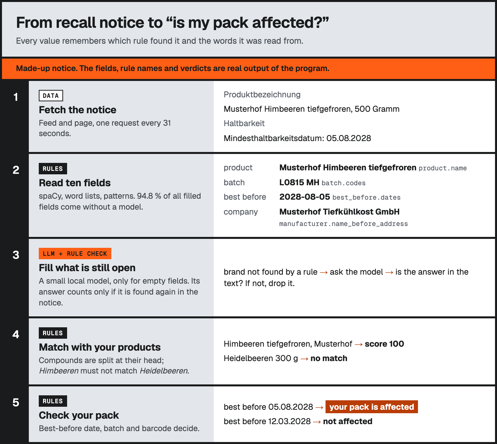
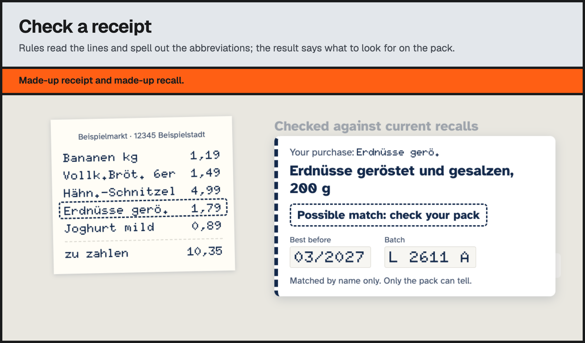

# Recall Monitor

Turns the official German food recall notices of [lebensmittelwarnung.de](https://www.lebensmittelwarnung.de) into structured
records and tells you when a recalled product matches one of your own products, including whether **your** pack is affected
(batch number, best-before date, barcode).

**Rules first, language model last.** Linguistic rules (spaCy, word lists, regular expressions, dependency patterns) fill the
fields. A small local model is asked only about fields the rules leave open, and its answer is kept only if it can be found
again in the notice. It runs as a command-line tool, a local web app and a static website.

## How it works



Every value stores where it came from (portal field, rule or model), the rule's name and the words it was read from:


Details of each step: [docs/PIPELINE.md](docs/PIPELINE.md).

## Key results

Measured on 225 current notices; accuracy on 100 of them, labelled by hand.

- **94.8 % of the filled fields need no model:** 46.0 % are copied from a portal field, 48.8 % come from rules.
- **The six fields that are read from text: 97.3 % precision and 89.5 % recall**, rules only, with the first version of the rules,
  written before the labels existed.
- **The weak spot is brands:** the rules find 43.4 % of them (all of those are right). The model finds most of the rest, and 78 % of
  its brands are right.


The rules were later improved on exactly these errors. On the same 100 notices they reach 99.9 % / 98.4 %, but that is fitted,
not measured, and not the number to quote. All tables: [docs/EVALUATION.md](docs/EVALUATION.md).

## Check a receipt

The website can also take a shop receipt (text, PDF, photo) and list purchases that may be on a recall list. Everything happens in
the browser; nothing is uploaded or stored.



A receipt shows no batch or date, so the result is never more than "possible match, check your pack". How it works, shop names and
the website: [docs/WEBSITE.md](docs/WEBSITE.md).

## Setup

```
python3.11 -m venv .venv && source .venv/bin/activate
pip install -e ".[dev]"
python -m spacy download de_core_news_sm
python -m pytest                  # some tests need Node.js
```

Then:

```
recall fetch                      # first time: about 2 hours
recall extract --no-llm           # rules only, about 3 seconds
cp data/my_products.example.csv data/my_products.csv
recall match && recall alert      # your alerts
recall serve                      # web app on http://127.0.0.1:8000
```

The first fetch is slow because the portal asks for 30 seconds between requests. For the model: `ollama pull gemma4:e2b-it-qat`, then
`recall extract` without `--no-llm`. Tests that need real notices or private receipts are skipped in a fresh copy.

## Known limits

- **Accuracy rests on 100 notices** from one portal and one period, and was measured for the first version of the rules.
- **Matching is not evaluated on hand labels.** Its weights were set by hand on test cases.
- **Receipt alerts are expected to be mostly false.** On 597 of my own receipts there were 6.5 alerts per 100; whether they are right
  has not been checked. Only Lidl's digital receipt was available as a real sample.
- **The website is not published**, and its update schedule is switched off.
- **Batch and date are checked separately.** A notice that pairs batch A with date X and batch B with date Y counts a pack with batch A and date Y as affected (it errs on the safe side).
- **Sellers** are named in fewer than half of the notices; when they are not, the app says so.
- **Brands** come from the rules for 81 notices and from the model for 102; the model's brands are the least certain values in the database.
- **One portal, one language.** Rules and lexicons are written for German notices from lebensmittelwarnung.de.
- **The feed only lists current notices.** Notices removed from the portal are marked inactive and hidden.

## Data and terms of use

The code is MIT ([`LICENSE`](LICENSE)). The portal's notices are not covered by it; its terms of use apply to them.

The portal's terms allow free, non-commercial reuse with a source line; republished notices must be
complete and unchanged and deleted when the portal removes them. So raw notices, the database, the gold
labels and your product list are **not committed** (`.gitignore`); run `recall fetch` to get your own
copy. The app shows a source line on every page, links every recall to the official notice, and hides
notices the portal has removed. `robots.txt` asks for 30 s between requests; the client waits 31 s, also
across runs.

*Words used here:* EAN = the number under a barcode · Impressum = the legal notice a public German website needs · Bundesländer =
the German federal states a notice applies to · Charge = batch.
