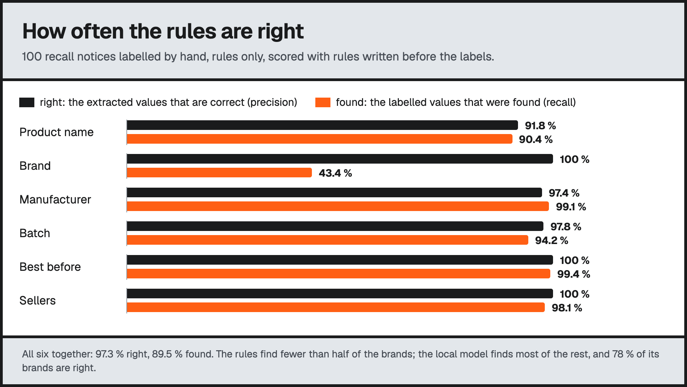
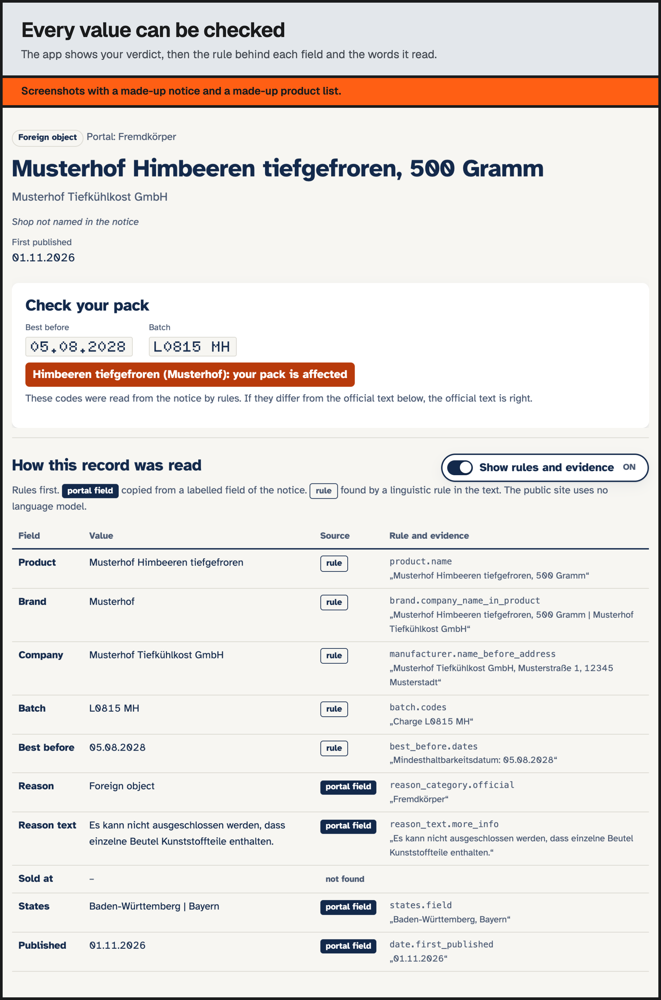

# recall-monitor

Turns the official German food recall notices of [lebensmittelwarnung.de](https://www.lebensmittelwarnung.de)
into structured records and tells you when a recalled product matches one of your own products,
including whether **your** pack is affected (batch number, best-before date, barcode).

**Rules first, LLM last.** Linguistic rules (spaCy, lexicons, regular expressions, dependency patterns)
fill the fields; a small local model (Gemma via Ollama) is asked only about fields the rules leave
open, and its answer is kept only where it can be found again in the notice.

```
recall fetch && recall extract --no-llm && recall match && recall alert
recall eval
recall serve        # web app on http://127.0.0.1:8000
```

## How it works


| Stage | Command | What it does |
|---|---|---|
| 1 fetch | `recall fetch` | Downloads the feed (at most hourly) and each notice page once, one request every 31 s as `robots.txt` asks. Raw responses are saved unchanged in `data/raw/`. A corrected notice gets a new version. |
| 2 extract | `recall extract` | Ten fields per notice: product name, brand, manufacturer, batch, best-before, reason category, reason text, sellers, federal states, date. Every value records its source (`structured` = copied from a labelled portal field, `rule`, `model`), the rule id and the text it was read from. |
| 3 fallback | (part of extract) | Only for open fields. `--no-llm` turns it off; without Ollama the run continues with rules only. |
| 4 normalise | (part of match) | Case and umlauts folded (notices write both *Käse* and *Kaese*), sizes and filler words dropped, compounds split at their head with a small food lexicon (*Rinderhackfleisch* → rinder + hackfleisch), lexicalised compounds kept whole (*Himbeeren* must not match *Heidelbeeren*), brand spellings mapped to one key. |
| 5 match | `recall match` | Score 0–100 from name overlap and brand agreement; an EAN on both sides decides; another brand never alerts. For each match: is your pack affected? (batch, best-before date incl. months and ranges, EAN), or which codes to look for. |
| 6 alert | `recall alert` | One line per match: product, reason, verdict, what to do, link. |
| 7 eval | `recall eval` | Share of fields from rules, run times, per-field precision and recall against hand labels. |

## Numbers (225 current notices, 12 Nov 2026)

| | |
|---|---|
| Fields filled | 1,987 of 2,250 (88.3 %); 37 more are fields the notice itself states as unknown |
| **Share of filled fields from rules alone** | **94.8 %** (914 copied from portal fields, 970 by rules, 103 by the model) |
| Rules only (`--no-llm`) | 1,884 of 2,250 fields filled (83.7 %) |
| **Field accuracy** (100 hand-labelled notices, 17 Nov 2026) | rules only: precision 99.2 %, recall 96.6 %; rules + model: 98.7 % / 98.5 %. Without the four fields that are copied from the portal: 97.3 % / 89.5 % and 95.8 % / 95.4 %. Per field below |
| **Run time** (MacBook M2, 8 GB) | extract `--no-llm`: 2.8 s for 225 notices; with the model: 397 s (193 model calls); match: 0.35 s for 10 products × 225 recalls; first fetch: about 2 h (crawl delay), then minutes |

Per field (filled / 225): product name 225, brand 183, manufacturer 219, batch 153, best-before 209,
reason category 225, reason text 221, sellers 102, states 225, date 225. Batch and seller are often
missing because the notice has none ("verschiedene Einzelhändler", every batch recalled).

### Accuracy against hand labels (measured 17 Nov 2026, 100 notices)



`recall eval` against `data/gold.csv`: 100 notices drawn at random (seed 20261112) from the 225, every field
labelled by hand without seeing the system's output. The rules scored here are those of v1.0.0 (commit 9958be9),
written before the labels existed. The rules have since been improved on exactly these errors (commit 473ff89);
on the same 100 notices they now reach 99.9 % / 98.4 % (rules only), which is fitted, not measured, and is
therefore not the number to quote. A measured number for the current rules needs a fresh labelled sample. Precision = share of extracted values that are right; recall = share of labelled
values that were found. A notice can have several values per field (several batches, several states).

| Field | Rules only (public site) P / R | Rules + model P / R | Where the errors are |
|---|---|---|---|
| product name | 91.8 % / 90.4 % | 91.8 % / 90.4 % | 9 of 100 notices wrong: decimal sizes split at the comma ("0,5 Liter" leaves ", 0"), "50 Gramm/60 Kapseln", several quoted products in one line |
| brand | 100 % / **43.4 %** | **87.2 %** / 90.4 % | the rules find 36 of 83 brands and all 36 are right; the model adds 50, of which 39 are right (78 %) |
| manufacturer | 97.4 % / 99.1 % | 97.4 % / 99.1 % | 3 notices: an address line, "Hersteller ..." and "Lieferant" taken as names |
| batch | 97.8 % / 94.2 % | 97.8 % / 94.2 % | 3 notices: batch only in the marking field, a UPC read as batch, batch with a time ("B1 03:08") |
| best before | 100 % / 99.4 % | 100 % / 100 % | |
| sellers | 100 % / 98.1 % | 100 % / 98.1 % | 1 notice: "TK Maxx" missed next to its company name |
| reason category, reason text, states, date | 100 % / 100 % | 100 % / 100 % | copied from labelled portal fields, so this mostly checks the copying |
| **all ten fields** | **99.2 % / 96.6 %** | **98.7 % / 98.5 %** | 1,142 of the 2,137 labelled values are federal states, which are copied; read this line with that in mind |
| **the six fields that are read, not copied** | **97.3 % / 89.5 %** (606 of 623 right, 606 of 677 found) | **95.8 % / 95.4 %** (646 of 674, 646 of 677) | |

The worst fields are **brand** (the rules miss more than half; the model finds most of the rest but one in five
of its brands is wrong) and **product name**. Rerun: `recall eval`.

**What the model does.** In the first full run the model filled 143 fields, with clear error types: dates
and barcodes as batch numbers, a country or an e-mail address as manufacturer, the recalling company as
seller, food words as brand ("Schnittkaese", "Bio Basmati Reis"). Each error type became a guard with its
own test. Now the model fills 102 brands and one date, and nothing else survives the guards. The gold set shows what
those brands are worth: on the 100 labelled notices, 39 of the model's 50 brands are right (78 %), against
36 of 36 for the rules.

## Your product list

`data/my_products.csv` (private, not committed). Copy `data/my_products.example.csv` to start, or use the web app.

```
name,brand,ean,batch,best_before,note
Spinat gehackt,K-Classic,,,31.10.2027,
```

Only `name` is needed. With a best-before date, batch or EAN from the pack, the alert says
*your pack is affected* / *not affected* instead of *check your pack*.

## Web app



`recall serve` opens a local web app: your alerts first, a live "check a product" form, all current
recalls with filters, a page per recall with the codes to compare with your pack, and a switch that
shows where each value came from (portal field, rule, model) with its evidence. Notices the portal
removes disappear from the app.

## Public website

`recall build-site` writes the public version as static files into `public/` (229 pages for 225 notices,
3.3 MB). It differs from the local app on purpose:

- **Rules only.** No language model runs on free hosting, so the site uses `recall extract --no-llm`.
- **Your product list never leaves your browser.** It is kept in localStorage and matched on the visitor's
  device by `recall/site/static/match.js`, a line-by-line port of the Python matcher.
  `tests/test_site_parity.py` sends the same products and recalls through both and requires equal scores,
  reasons and verdicts (checked to fail when the JavaScript is changed).
- **Each notice complete and unchanged.** Every recall page shows the official text with the portal's own
  labels, next to the values read from it; no product photos (they belong to the companies).
- **Nothing from other servers.** Fonts are self-hosted (OFL), no cookies, no analytics; a test checks
  that no page loads anything from elsewhere.
- **Updated every three hours** by `.github/workflows/site.yml` on GitHub Actions and published on GitHub
  Pages, once the schedule in that file is switched on (it starts by hand by default). Fetched notices are kept in the Actions cache, so each page is downloaded once, 31 s apart.
- **`--public` refuses to build without an Impressum** in `site.json`.

To publish a copy: fill in `site.json` (Impressum, repository link) and check the portal's terms of use first.

Preview locally: `recall build-site && python -m http.server -d public 8001`.

## Check a receipt

The website's page **Check a receipt** takes a shop receipt and lists the purchases that may be on a recall
list, with the batch, best-before date and barcode to look for on the pack. Everything happens in the browser:
the receipt is not uploaded, not stored, and the picture is dropped from memory once it is read.

```
receipt (pasted text, .txt, PDF, photo or screenshot)
  -> lines read by rules (layout of the Lidl digital receipt; other text: one product per line)
  -> abbreviations spelt out from a hand-made list ("Vollk." -> Vollkorn)      recall/lexicons/receipt_abbrev.tsv
  -> you check and correct every line, the shop and the date
  -> the product-list matcher, by name (a receipt has no brand, batch or date)
  -> "possible match, check your pack"; less likely when the notice names other shops only or the dates rule it out
```

- **Rules first.** Reading a receipt is done by rules (`recall/receipt.py`, ported line by line to
  `recall/site/static/receipt.js`; `tests/test_receipt_parity.py` requires equal answers, also on the 597 real receipts
  when they are on the machine). No language model reads the receipt.
- **PDF** files with a text layer are read with pdf.js; **pictures** with Tesseract.js (WebAssembly, German model).
  Both are served from the site itself (`recall/site/static/vendor/`, Apache-2.0) and loaded only when needed: about
  1.8 MB for a PDF, about 5.5 MB once for a picture. HEIC photos open in Safari but not in Chrome or Edge; the page
  says so and asks for a JPG or screenshot.
- **Built for one layout.** Lidl's digital receipt is the only layout with real samples (597 of the author's own
  receipts, which stay private). Other shops' receipts are read as "one product per line" and are not evaluated.
- A receipt match **never says "affected"**: a receipt carries no batch or best-before date. It says
  "possible match: check your pack" and states when the match rests on the name only.

### Numbers (17 Nov 2026; `python scripts/receipt_eval.py` and `node tools/ocr_eval.mjs`)

Kept apart on purpose; synthetic numbers are labelled as such.

| What | Data | Result |
|---|---|---|
| Line extraction | 597 real Lidl receipts (text), against an independent parse | **597/597** add up to the printed total; 0 lines not understood |
| Abbreviations spelt out | 100 real descriptions, held out from the lexicon | **not measured yet** |
| **Alerts on real shopping** | 597 receipts, 4,316 product lines, 225 recalls | **6.5 alerts per 100 receipts** with shop and date narrowing (29.8 by name alone); whether they are right is **not measured yet** (94 pairs to label). The author's purchases contain few or no recalled products, so these alerts are expected to be mostly false |
| Finding a recalled product | SYNTHETIC: receipt-style lines written by rule from the 225 recalled products | 168/225 found; optimistic, the lines come from the very names they must match |
| Reading pictures (Tesseract.js) | SYNTHETIC: 12 real receipt texts typeset as pictures, clean / mild / hard (skew, blur, grain) | product lines read with the right price and name: 94 % / 76 % / 65 %; about 1 s per receipt. **Photos of paper receipts: not measured yet** |

A local vision model (Gemma 4 E2B through Ollama) was compared on 3 of the synthetic receipts: it read 13/15,
11/15 and 6/15 lines exactly (Tesseract.js on the same three: 15/15, 12/15, 7/15) and took 17 to 20 s per receipt;
it also cannot run on a static website. Tesseract.js was chosen on these numbers.

Hand labels for the two "not measured" rows: `python scripts/label_app.py` opens a local labelling page that
writes them; then `python scripts/receipt_eval.py` reports them.

## Which shop sold it

When a notice names the shop that sold the product, the recall page, the list and the result cards show it:
the shop's name in a small chip, and on a recall page that names exactly one shop, a band in that shop's colour
above the header. Several shops: one chip each and no band. No shop named (123 of 225 notices): the plain words
"Shop not named in the notice". On the receipt page the receipt's own shop marks each result ("Your Lidl purchase").

- **Colours only where the shop declares them itself.** No retailer publishes colour values on a brand or press
  page (searched 17 Nov 2026). Four declare one in their own website's code (`theme-color`, tile colour or web-app
  manifest): Lidl, Aldi Nord, denn's BioMarkt and Combi. Those values are used, with page, tag and date in
  `recall/lexicons/retailer_style.json`; every other shop is shown by name in the neutral style. Colour lists from
  third-party sites are not used.
- **Never mistaken for a verdict.** Orange (affected) and emerald (not affected) stay the only verdict colours. A shop
  colour is never set behind text, and `tests/test_retailers.py` checks that every shop colour keeps a clear distance
  (CIE76 ΔE ≥ 25) from every verdict colour and that all text next to it reaches WCAG AA (4.5:1) in light and dark mode.
- **Never on the notice.** The colour frames the page header; the official notice text below is not touched.
- **No logos.** The site names shops in its own typeface and says on every page that it is independent of all shops.

## Motion

Two kinds of motion, each with the tool that fits it:

- **On the pages:** `recall/site/static/motion.js` (about 4 KB, no library) uses the browser's Web Animations API, and
  `site.css` turns on cross-document View Transitions for a short cross-fade between pages where the browser supports
  them. Read receipt lines come in one by one, results arrive where the eye is, a corrected line and a changed result
  are marked in place, a removed line slides out. Only transform and opacity are animated. With "reduce motion" set in
  the operating system nothing moves and every change is instant. Every result change is also said in words to
  screen readers. Measured in headless Edge (receipt flow, M2): one frame over 34 ms in about 300, 2 tasks over 50 ms
  (longest 63 ms, the matching itself), layout shift 0.007; with the CPU slowed four times, one slow frame (about
  100 to 130 ms) at each step, again the computation before an animation starts. Check: `node tools/check_motion.mjs <url>`.
- **The story video:** a 10-second made-up example (receipt photographed, lines read, checked, one possible match),
  made with Remotion in `motion/` and rendered to `recall/site/static/media/` (WebM 0.6 MB for the site, MP4 0.5 MB,
  poster). It plays only while it is on screen, never by itself with reduced motion, and has a pause button. The site
  build does not need Node; to change the video: `cd motion && npm install && npm run render`. Remotion is free for
  individuals and companies of up to three people (its licence, checked 17 Nov 2026); a larger company would need a
  company licence.

## Evaluation

```
recall eval --template      # writes data/gold_template.csv: 100 random notices (seed 20261112), empty labels
# label by hand, save as data/gold.csv
recall eval                 # per-field precision / recall, split by source; saves data/eval_report.json
```

Label format: values separated by ` | `; dates as `2028-03-01` (month `2028-03`, range
`2027-05-31..2027-07-02`, every date `alle`); `-` when the notice states no value; an empty cell when not
labelled. The template shows no system output, so the labels are not anchored by it.

## Known limits

- **Extraction accuracy rests on 100 notices** from one portal and one period (see above). **Matching is not evaluated on hand labels**: its weights and thresholds were set by hand on the test cases in `tests/test_match.py`, not tuned on labelled data.
- **Batch and date are checked separately.** A notice that pairs batch A with date X and batch B with date Y counts a pack with batch A and date Y as affected (it errs on the safe side).
- **Sellers** are named in fewer than half of the notices; when they are not, the app says so.
- **Brands** come from the rules for 81 notices and from the model for 102; the model's brands are the least certain values in the database.
- **One portal, one language.** Rules and lexicons are written for German notices from lebensmittelwarnung.de.
- **The feed only lists current notices.** Notices removed from the portal are marked inactive and hidden.

## Data and terms of use

The code is MIT ([`LICENSE`](LICENSE)). The portal's notices are not covered by it; its terms of use apply to them.

The portal's terms allow free, non-commercial reuse with a source line; republished notices must be
complete and unchanged and deleted when the portal removes them. So raw notices, the database, the gold
labels and your product list are **not committed** (`.gitignore`); run `recall fetch` to get your own
copy. The app shows a source line on every page, links every recall to the official notice, and hides
notices the portal has removed. `robots.txt` asks for 30 s between requests; the client waits 31 s, also
across runs.

## Setup and tests

```
python3.11 -m venv .venv && source .venv/bin/activate
pip install -e ".[dev]" && python -m spacy download de_core_news_sm
ollama pull gemma4:e2b-it-qat        # optional, for the fallback
python -m pytest                      # 457 tests, no network (the parity tests need Node.js)
```

Tests that read real notices use two raw files from `data/raw/` and are skipped when those are missing.
