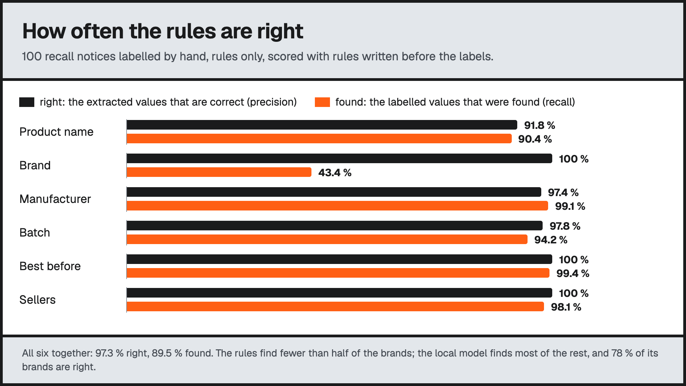

# Evaluation

Two things are measured: how well the fields are read from a notice, and how the receipt check behaves. Matching of products
and recalls is **not** evaluated on hand labels. `data/match_cases.csv` holds 30 written cases that `recall eval` runs as a
regression check.

## How the fields are filled (225 notices, 12 Nov 2026)

| What | Result |
|---|---|
| Fields filled | 1,987 of 2,250 (88.3 %); 37 more are fields the notice itself states as unknown |
| **Filled without a model** | **94.8 %**: 46.0 % copied from a portal field (914), 48.8 % by rules (970) |
| Filled by the model | 5.2 % (103) |
| Rules only (`--no-llm`) | 1,884 of 2,250 fields filled (83.7 %) |
| Time, rules only | 2.8 s for 225 notices (MacBook M2, 8 GB) |
| Time, with the model | 391 s (193 model calls) |
| Time, matching | 0.35 s for 10 products × 225 recalls |
| First fetch | about 2 h, because of the crawl delay; later runs take minutes |

Per field (filled / 225): product name 225, brand 183, manufacturer 219, batch 153, best-before 209,
reason category 225, reason text 221, sellers 102, states 225, date 225. Batch and seller are often
missing because the notice has none ("verschiedene Einzelhändler", every batch recalled).

## Accuracy against hand labels (100 notices, 17 Nov 2026)



`recall eval` against `data/gold.csv`: 100 notices drawn at random (seed 20261112) from the 225, every field
labelled by hand without seeing the system's output. The rules scored here are the first version,
written before the labels existed. The improved version in this repository was written on exactly these
errors; on the same 100 notices it reaches 99.9 % / 98.4 % (rules only), which is fitted, not measured, and is
therefore not the number to quote. A measured number for the improved rules needs a fresh labelled sample.

Precision = share of extracted values that are right; recall = share of labelled
values that were found. A notice can have several values per field (several batches, several states).

| Field | Rules only (public site) P / R | Rules + model P / R | Where the errors are |
|---|---|---|---|
| product name | 91.8 % / 90.4 % | 91.8 % / 90.4 % | 9 of 100 notices wrong: decimal sizes split at the comma ("0,5 Liter" leaves ", 0"), "50 Gramm/60 Kapseln", several quoted products in one line |
| brand | 100 % / **43.4 %** | **87.2 %** / 90.4 % | the rules find 36 of 83 brands and all 36 are right; the model adds 50, of which 39 are right (78 %) |
| manufacturer | 97.4 % / 99.1 % | 97.4 % / 99.1 % | 3 notices: an address line, "Hersteller ..." and "Lieferant" taken as names |
| batch | 97.8 % / 94.2 % | 97.8 % / 94.2 % | 3 notices: batch only in the marking field, a UPC read as batch, batch with a time ("B1 03:08") |
| best before | 100 % / 99.4 % | 100 % / 100 % | |
| sellers | 100 % / 98.1 % | 100 % / 98.1 % | 1 notice: "TK Maxx" missed next to its company name |
| reason category, reason text, states, date | 100 % / 100 % | 100 % / 100 % | mostly copied from labelled portal fields (all but 24 reason categories), so this mainly checks the copying |
| **all ten fields** | **99.2 % / 96.6 %** | **98.7 % / 98.5 %** | 1,142 of the 2,118 labelled values are federal states, which are copied; read this line with that in mind |
| **the six fields above, which are read from text** | **97.3 % / 89.5 %** (606 of 623 right, 606 of 677 found) | **95.8 % / 95.4 %** (646 of 674, 646 of 677) | |

The worst fields are **brand** (the rules miss more than half; the model finds most of the rest but one in five
of its brands is wrong) and **product name**. The labels file `data/gold.csv` is not in
this repository (it repeats portal text), so `recall eval` cannot repeat these numbers here; the saved report is
[`data/eval_report.json`](../data/eval_report.json) (rules + model). Of the extracted values in
the six fields, 37 (26 product names and 11 manufacturers) were copied straight from a labelled field.

**What the model does.** In the first full run the model filled 143 fields, with clear error types: dates
and barcodes as batch numbers, a country or an e-mail address as manufacturer, the recalling company as
seller, food words as brand ("Schnittkaese", "Bio Basmati Reis"). Each error type became a guard with its
own test. Now the model fills 102 brands and one date, and nothing else survives the guards. The gold set shows what
those brands are worth: on the 100 labelled notices, 39 of the model's 50 brands are right (78 %), against
36 of 36 for the rules.

### Labelling your own sample

```
recall eval --template   # 100 random notices, empty labels
# label data/gold_template.csv by hand, save as data/gold.csv
recall eval              # precision and recall per field
```

Label format: values separated by ` | `; dates as `2028-03-01` (month `2028-03`, range
`2027-05-31..2027-07-02`, every date `alle`); `-` when the notice states no value; an empty cell when not
labelled. The template shows no system output, so the labels are not anchored by it.

## The receipt check (17 Nov 2026)

Scripts: `python scripts/receipt_eval.py` and `node tools/ocr_eval.mjs`. Kept apart on purpose; synthetic numbers are labelled as such.

| What | Data | Result |
|---|---|---|
| Line extraction | 597 real Lidl receipts (text), against an independent parse | **597/597** add up to the printed total; 0 lines not understood |
| Abbreviations spelt out | 100 real descriptions, held out from the lexicon | **not measured yet** |
| **Alerts on real shopping** | 597 receipts, 4,316 product lines, 225 recalls | **6.5 alerts per 100 receipts** with shop and date narrowing (29.8 by name alone); whether they are right is **not measured yet** (94 pairs to label). The author's purchases contain few or no recalled products, so these alerts are expected to be mostly false |
| Finding a recalled product | SYNTHETIC: receipt-style lines written by rule from the 225 recalled products | 168/225 found; optimistic, the lines come from the very names they must match |
| Reading pictures (Tesseract.js) | SYNTHETIC: 12 real receipt texts typeset as pictures, clean / mild / hard (skew, blur, grain) | product lines read with the right price and name: 94 % / 76 % / 65 %; about 1 s per receipt. **Photos of paper receipts: not measured yet** |

A local vision model (Gemma 4 E2B through Ollama) was compared on 3 of the synthetic receipts: it read 13/15,
11/15 and 6/15 lines exactly (Tesseract.js on the same three: 15/15, 12/15, 7/15) and took 17 to 20 s per receipt;
it also cannot run on a static website. Tesseract.js was chosen on these numbers.

Hand labels for the two "not measured" rows: `python scripts/label_app.py` opens a local labelling page that
writes them; then `python scripts/receipt_eval.py` reports them.
