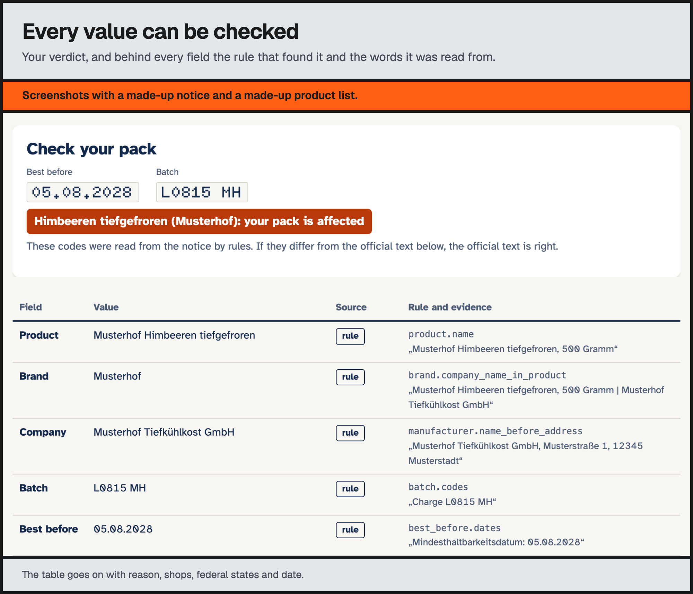

# Local app and website

## Local app

`recall serve` opens a local web app: your alerts first, a live "check a product" form, all current
recalls with filters, a page per recall with the codes to compare with your pack, and a switch that
shows where each value came from (portal field, rule, model) with its evidence. Notices the portal
removes disappear from the app.

## Static website

`recall build-site` writes the public version as static files into `public/` (230 pages for 225 notices;
15 MB, of which 12 MB are fonts, the video and the PDF and OCR libraries). It differs from the local app on purpose:

- **Rules only.** No language model runs on free hosting, so the site uses `recall extract --no-llm`.
- **Your product list never leaves your browser.** It is kept in localStorage and matched on the visitor's
  device by `recall/site/static/match.js`, a line-by-line port of the Python matcher.
  `tests/test_site_parity.py` sends the same products and recalls through both and requires equal scores,
  reasons and verdicts (checked to fail when the JavaScript is changed).
- **Each notice complete and unchanged.** Every recall page shows the official text with the portal's own
  labels, next to the values read from it; no product photos (they belong to the companies).
- **Nothing from other servers.** Fonts are self-hosted (OFL), no cookies, no analytics; a test checks
  that no page loads anything from elsewhere.
- **Can update every three hours** with `.github/workflows/site.yml` on GitHub Actions and GitHub Pages. The
  schedule is switched off and the site is not published; the workflow starts by hand only. Fetched notices are kept in the Actions cache, so each page is downloaded once, 31 s apart.
- **`--public` refuses to build without an Impressum** (the legal notice a public German website needs) in `site.json`.

To publish a copy: fill in `site.json` (Impressum, repository link) and check the portal's terms of use first.

Preview locally: `recall build-site && python -m http.server -d public 8001`.

## Receipt check

The website's page **Check a receipt** takes a shop receipt and lists the purchases that may be on a recall
list, with the batch, best-before date and barcode to look for on the pack. Everything happens in the browser:
the receipt is not uploaded, not stored, and the picture is dropped from memory once it is read.

1. The receipt comes in as pasted text, .txt, PDF, photo or screenshot.
2. Rules read the lines (layout of the Lidl digital receipt; other text: one product per line).
3. Abbreviations are spelt out from a hand-made list (*Vollk.* → *Vollkorn*, `recall/lexicons/receipt_abbrev.tsv`).
4. You check and correct every line, the shop and the date.
5. The product-list matcher compares by name, because a receipt has no brand, batch or date.
6. The result is "possible match, check your pack"; less likely when the notice names other shops only or the dates
   rule it out.

- **Rules first.** Reading a receipt is done by rules (`recall/receipt.py`, ported line by line to
  `recall/site/static/receipt.js`; `tests/test_receipt_parity.py` requires equal answers, also on the 597 real receipts
  when they are on the machine). No language model reads the receipt.
- **PDF** files with a text layer are read with pdf.js; **pictures** with Tesseract.js (WebAssembly, German model).
  Both are served from the site itself (`recall/site/static/vendor/`, Apache-2.0) and loaded only when needed: about
  1.8 MB for a PDF, about 5.5 MB once for a picture. HEIC photos open in Safari but not in Chrome or Edge; the page
  says so and asks for a JPG or screenshot.
- **Built for one layout.** Lidl's digital receipt is the only layout with real samples (597 of the author's own
  receipts, which stay private). Other shops' receipts are read as "one product per line" and are not evaluated.
- A receipt match **never says "affected"**: a receipt carries no batch or best-before date. It says
  "possible match: check your pack" and states when the match rests on the name only.

Numbers: [EVALUATION.md](EVALUATION.md#the-receipt-check-17-nov-2026).

## Which shop sold it

When a notice names the shop that sold the product, the recall page, the list and the result cards show it:
the shop's name in a small chip, and on a recall page that names exactly one shop, a band in that shop's colour
above the header. Several shops: one chip each and no band. No shop named (123 of 225 notices): the plain words
"Shop not named in the notice". On the receipt page the receipt's own shop marks each result ("Your Lidl purchase").

- **Colours only where the shop declares them itself.** No retailer publishes colour values on a brand or press
  page (searched 17 Nov 2026). Four declare one in their own website's code (`theme-color`, tile colour or web-app
  manifest): Lidl, Aldi Nord, denn's BioMarkt and Combi. Those values are used, with page, tag and date in
  `recall/lexicons/retailer_style.json`; every other shop is shown by name in the neutral style. Colour lists from
  third-party sites are not used.
- **Never mistaken for a verdict.** Orange (affected) and emerald (not affected) stay the only verdict colours. A shop
  colour is never set behind text, and `tests/test_retailers.py` checks that every shop colour keeps a clear distance
  (CIE76 ΔE ≥ 25) from every verdict colour and that all text next to it reaches WCAG AA (4.5:1) in light and dark mode.
- **Never on the notice.** The colour frames the page header; the official notice text below is not touched.
- **No logos.** The site names shops in its own typeface and says on every page that it is independent of all shops.

## Motion

Two kinds of motion, each with the tool that fits it:

- **On the pages:** `recall/site/static/motion.js` (about 4 KB, no library) uses the browser's Web Animations API, and
  `site.css` turns on cross-document View Transitions for a short cross-fade between pages where the browser supports
  them. Read receipt lines come in one by one, results arrive where the eye is, a corrected line and a changed result
  are marked in place, a removed line slides out. Only transform and opacity are animated. With "reduce motion" set in
  the operating system nothing moves and every change is instant. Every result change is also said in words to
  screen readers. Measured in headless Edge (receipt flow, M2): one frame over 34 ms in about 300, 2 tasks over 50 ms
  (longest 63 ms, the matching itself), layout shift 0.007; with the CPU slowed four times, one slow frame (about
  100 to 130 ms) at each step, again the computation before an animation starts. Check: `node tools/check_motion.mjs <url>`.
- **The story video:** a 10-second made-up example (receipt photographed, lines read, checked, one possible match),
  made with Remotion in `motion/` and rendered to `recall/site/static/media/` (WebM 0.6 MB for the site, MP4 0.5 MB,
  poster). It plays only while it is on screen, never by itself with reduced motion, and has a pause button. The site
  build does not need Node; to change the video: `cd motion && npm install && npm run render`. Remotion is free for
  individuals and companies of up to three people (its licence, checked 17 Nov 2026); a larger company would need a
  company licence.
